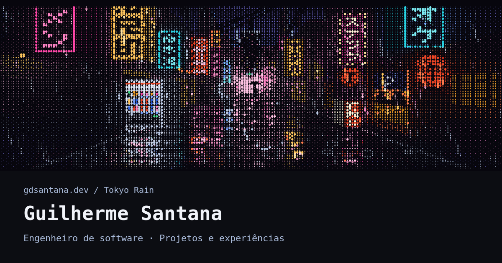

  

  <a href="https://gdsantana.dev">Portfólio</a> ·
  <a href="https://www.linkedin.com/in/gdsantana/">LinkedIn</a> ·
  <a href="https://x.com/gdsantana">X</a> ·
  <a href="https://www.instagram.com/gdsantana.dev">Instagram</a>

## `// sobre`

Sou **Guilherme Santana**, engenheiro de software focado em plataformas web escaláveis, arquitetura frontend, performance e experiências em tempo real orientadas a dados.

Atualmente na **Azion**, desenvolvo interfaces para ferramentas de edge, padrões de UI e estratégias de cache no navegador para entregar dados de forma instantânea.

`Porto Alegre, Brasil` · `Código e chimarrão.`

## `// tecnologias`

  
  
  
  
  
  

## `// projetos`

**[RatoMusicBot](https://github.com/gdsantana/RatoMusicBot)** · `Node.js / Next.js`

Bot de música para Discord com comandos slash, filas por servidor e controles de reprodução. [Ver projeto ↗](https://ratomusicbot.gdsantana.dev)

**GPPD-HPC-Coder** · `Python / CUDA`

Pesquisa sobre adaptação de modelos de linguagem pequenos (SLMs) para geração de código CUDA em computação de alto desempenho.

**[Azion Console](https://console.azion.com/)** · `Vue.js / UI`

Trabalho profissional em interfaces de produto para a plataforma Azion.

[Mais sobre projetos e experiência no portfólio ↗](https://gdsantana.dev)

## `// atividade`

  

  
Ver sequência de contribuições

   
  

    
  

---

  <code>gdsantana.dev / Tokyo Rain</code> 
  Para conversar sobre produtos, código ou uma próxima ideia: <a href="https://www.linkedin.com/in/gdsantana/">LinkedIn ↗</a>

